# 轻笺 Lightnote

一个**轻量、清爽、本地优先**的桌面备忘录 / 待办应用。不登录、不联网、打开就能写。

[](https://github.com/wzliwzli/lightnote/releases/latest)
[](LICENSE)
[](#系统要求)

界面是 React + TypeScript + framer-motion，构建时内联成**一个 HTML**；桌面外壳是几 MB 的 WebView2 窗口，**无边框悬浮在桌面上，常驻右下角托盘**，不占任务栏。

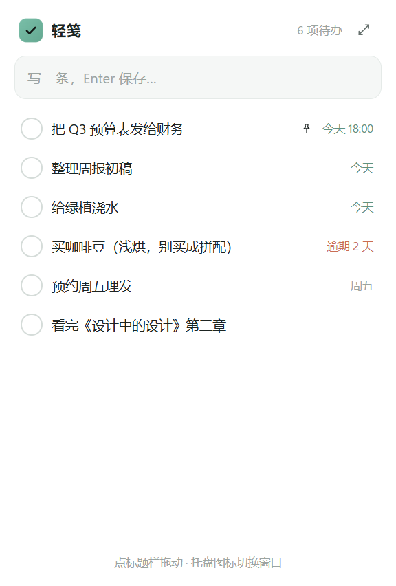

> **v1.3** —— 透明度只作用于悬浮窗（完整窗口始终不透明）；悬浮窗边缘缩放修好；附带可直接分发的压缩包。

## 下载 / 分发

`release\Lightnote-win64-v1.3.zip`（约 390 KB）—— 解压到任意文件夹，双击 `Lightnote.exe` 即可用，
不需要安装 .NET、Node 或浏览器（用的是系统自带的 WebView2）。

包内结构：

```
Lightnote/
  Lightnote.exe                        47 KB
  web/index.html                      345 KB
  Microsoft.Web.WebView2.Core.dll     682 KB
  Microsoft.Web.WebView2.WinForms.dll  38 KB
  WebView2Loader.dll                  190 KB
  使用说明.txt
```

> exe 和 web 文件夹、dll 必须放在一起，不能只拷 exe。

## 桌面版怎么用

双击 `desktop\build\Lightnote.exe`。

- 打开就是右下角的**悬浮小窗**：拖标题栏移动，**拖四条边调整大小**，位置和尺寸都会记住
- **透明度可调**（设置 → 悬浮窗透明度，40%–100%，默认 95%）：只作用于悬浮窗，**完整窗口始终不透明**
- **默认不置顶** —— 像桌面挂件一样待在普通层级，被其他窗口盖住是正常的；想要「永远浮在最前」，在托盘菜单勾「总在最前」
- **不在任务栏占位**，收在右下角托盘的小三角里
- 窗口圆角和投影交给系统画（Win11），不是 CSS 假阴影
- 点小窗右上角的 ⤢ 展开成**完整窗口**（这时才出现在任务栏）；完整窗口再点标题栏的按钮或按 `Ctrl M` 收回小窗
- 点 × 只是**隐藏到托盘**；真退出在托盘菜单里「退出轻笺」
- 托盘图标双击 = 唤起窗口；右键菜单可以切换悬浮 / 完整、总在最前、退出
- 数据存在 `%LOCALAPPDATA%\Lightnote\`；想放桌面就右键 exe → 发送到 → 桌面快捷方式

## 网页版怎么用

```bat
scripts\dev.cmd
```

浏览器打开 <http://127.0.0.1:5179/>；`dist\index.html` 是单文件版，双击直接在浏览器里用。

## 能做什么

**记录**

- 顶部单行输入，`Enter` 保存；语法：`!!` 紧急 / `!` 重要 / `*` 置顶 / `#标签`（可写多个）
- 备注：悬停卡片点「备注」图标，卡片上会显示一行预览
- 重复：每天 / 每周 / 每月。勾掉后这一份留作记录，同时自动生成下一次

**整理**

- 四种视图：今日 / 全部 / 已完成 / 置顶
- 标签多选筛选，可切换**并集** / **交集**
- 实时搜索（`Ctrl K`）、悬停操作条、**拖拽调整顺序**

**操作**（悬停卡片右侧）

| 图标 | 作用 |
| --- | --- |
| 便签 | 备注 |
| 旗子 | 切换重要度（普通 → 重要 → 紧急） |
| 日历 | 截止日期 + 重复 |
| 图钉 | 置顶 |
| 沙漏 | 开始专注 |
| 垃圾桶 | 删除（5 秒内可撤销） |

**时间机制**

- 「今日」里今天完成的任务留到当天结束，第二天归档到「已完成」
- 「全部」里完成的任务按设置的时长保留（关闭 / 1h / 6h / 24h / 3d / 永久）

**专注**

- 番茄钟：15 / 25 / 45 分钟，顶栏和悬浮窗顶部都有倒计时环，结束响一声

**数据**

- 全部存在本机；可导出 JSON（可再导入）/ Markdown，导入前二次确认

**外观**

- 5 套主题预设 + 自定义主色 + 深浅色 + 圆角 / 字号
- 桌面版：悬浮窗透明度 40%–100%

**设置**

- 主面板只放常用项：完成保留时长、悬浮窗透明度
- 「拓展设置」放标签匹配方式、专注时长、导入导出
- 底部「恢复默认设置」，二次确认后把偏好重置为初始值

## 界面

| | |
| --- | --- |
| 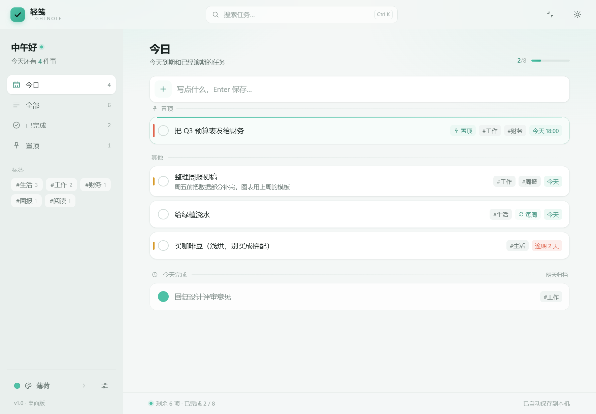 | 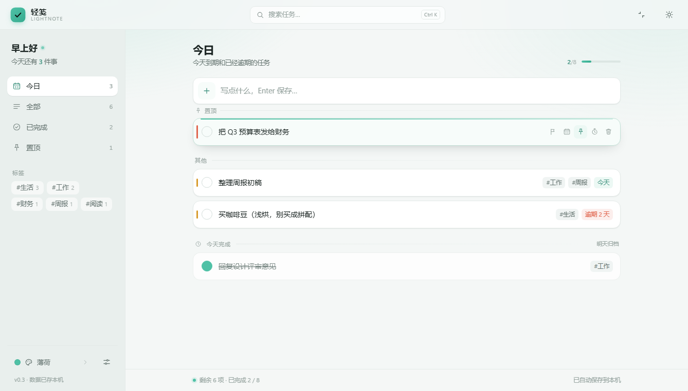 |
| 展开后的完整窗口 | 悬停显示操作条 |
| 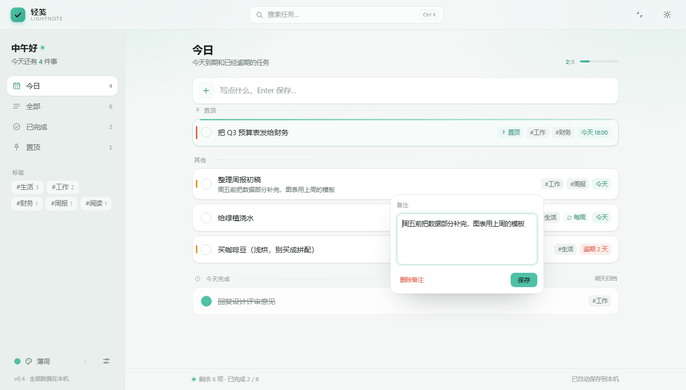 | 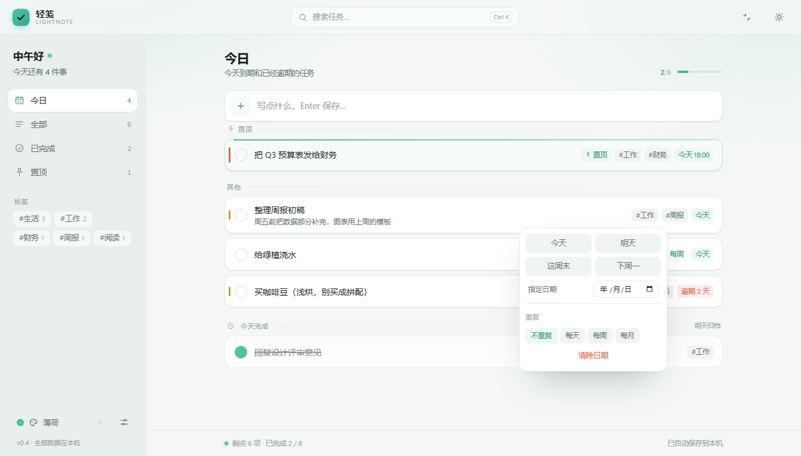 |
| 备注 | 日期 + 重复 |
| 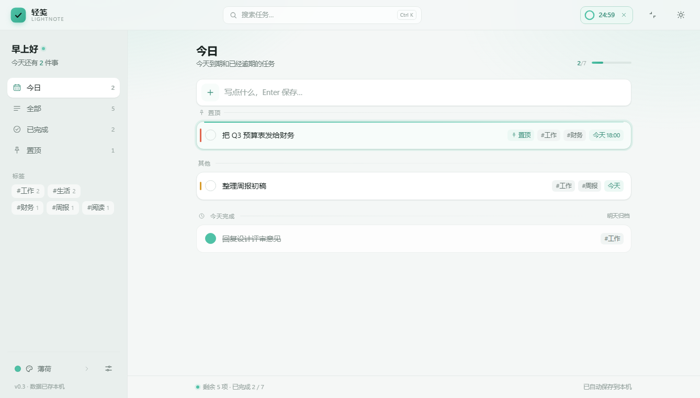 | 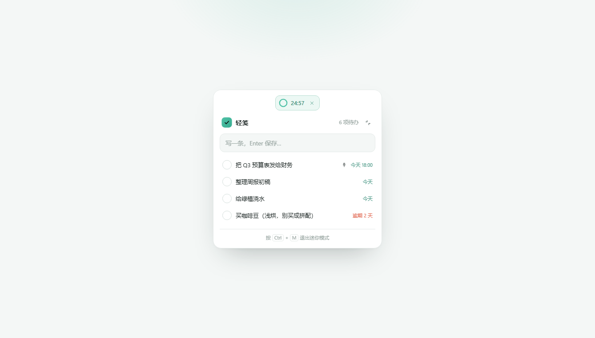 |
| 顶栏专注倒计时 | 迷你模式顶部显示倒计时 |
| 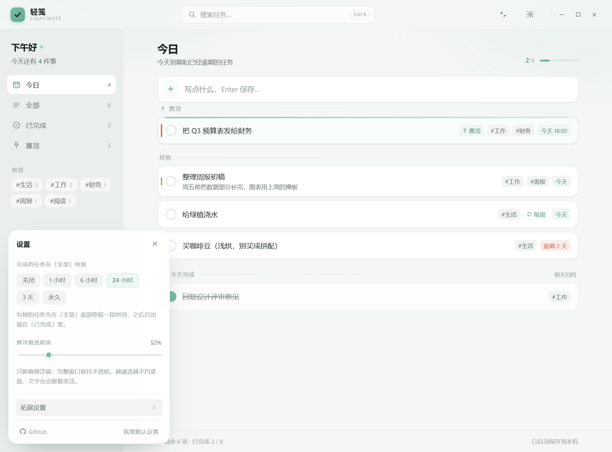 | 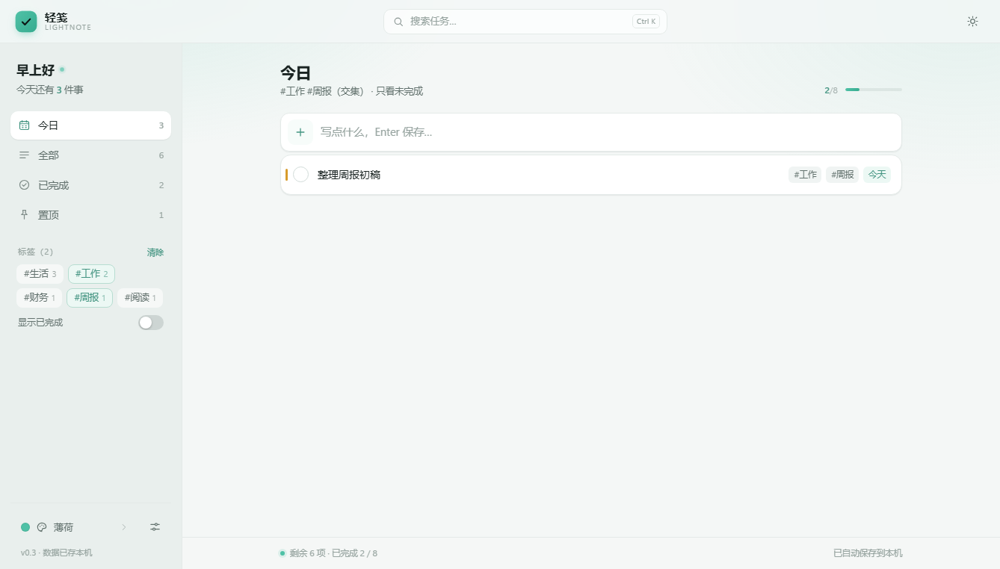 |
| 设置面板 | 多标签取交集 |
| 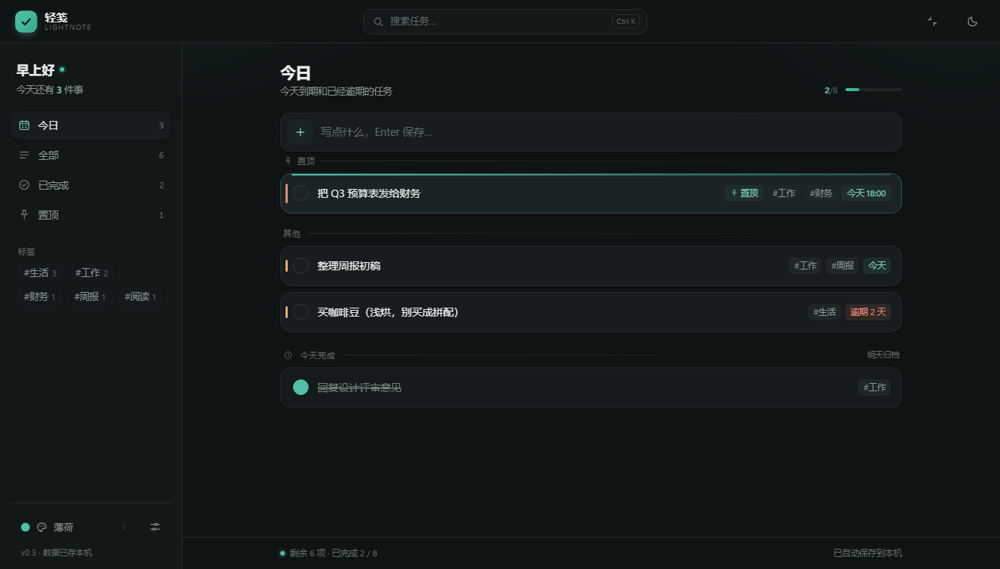 | 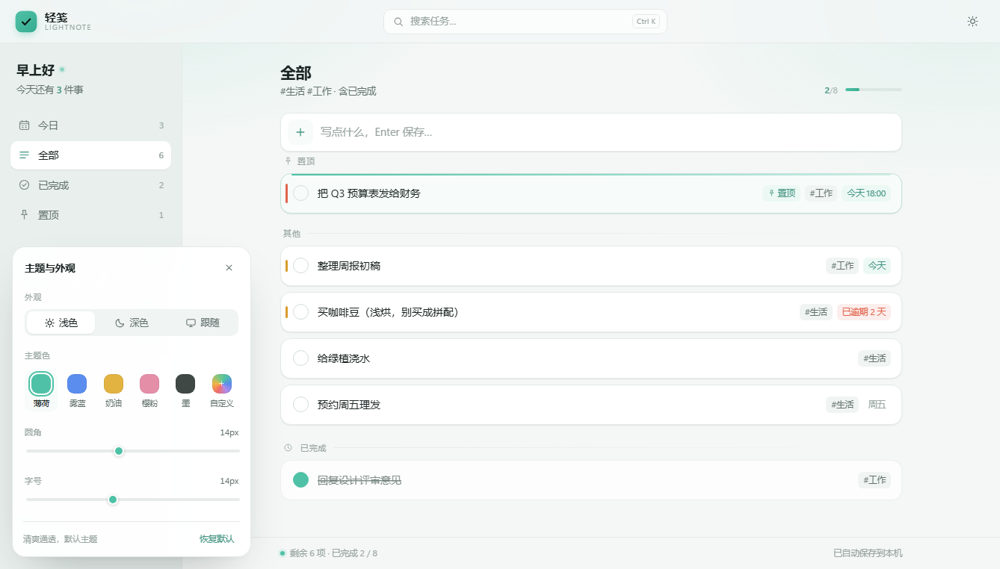 |
| 深色模式 | 主题引擎 |

「全部」里完成的任务会掉到列表底部：

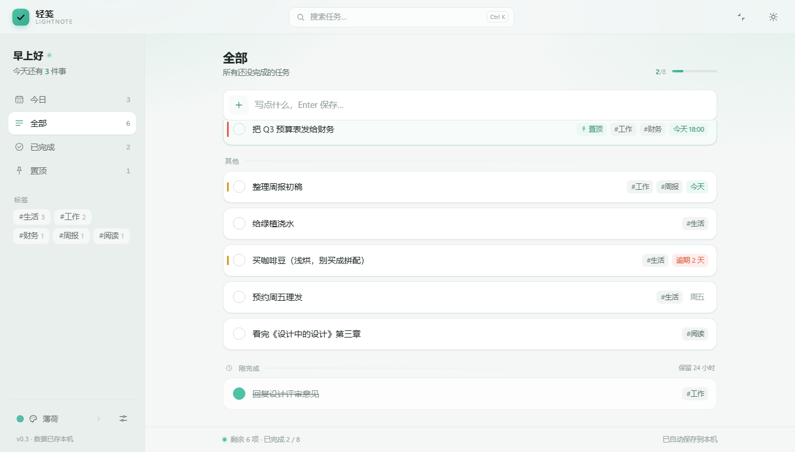

## 快捷键

| 操作 | 快捷键 |
| --- | --- |
| 保存 / 新建 | `Enter` |
| 取消编辑、关面板、清搜索 | `Esc` |
| 搜索 | `Ctrl K` |
| 收起 / 展开窗口（桌面版） | `Ctrl M` |
| 迷你模式（网页版） | `Ctrl M` |
| 撤销删除 | `Ctrl Z` |
| 保存备注 | `Ctrl Enter` |
| 编辑标题 | 双击标题 |

## 桌面壳是怎么做的

`desktop/src/Lightnote.cs` 是一个 WinForms + WebView2 宿主，200 多行：

- 用 .NET Framework 自带的 `csc.exe` 编译，**不需要 .NET SDK、不需要 Rust、不需要 Visual Studio**
- `FormBorderStyle = None` + `ShowInTaskbar = false` + `TopMost` → 无边框悬浮窗，不占任务栏
- 拖拽：页面里按下标题栏时给宿主发 `drag`，宿主 `ReleaseCapture()` + `SendMessage(WM_NCLBUTTONDOWN, HTCAPTION)`，交给系统处理，拖动跟原生窗口一样跟手
- `NotifyIcon` 托盘图标 + 右键菜单；关窗口 = 隐藏到托盘，真退出走菜单
- 页面用虚拟域名 `https://lightnote.local` 加载（不是 `file://`），localStorage 才有稳定 origin
- 页面和宿主用一条消息通道约定模式：`?mode=float` 首帧就渲染成小窗，避免闪一下完整界面
- 按系统 DPI 缩放算窗口尺寸（150% 缩放下不会误判成窄屏）
- `--selftest` 参数静默启动、等页面加载完写日志退出，用来做自查

产物只依赖系统自带的 WebView2 运行时：

```
desktop/build/
  Lightnote.exe                       29 KB
  web/index.html                     349 KB
  Microsoft.Web.WebView2.Core.dll    682 KB
  Microsoft.Web.WebView2.WinForms.dll 38 KB
  WebView2Loader.dll                 190 KB
```

重新打包：`scripts\build-desktop.cmd`（会先跑 `tsc` + `vite build` 再编译外壳；第一次要联网下载 WebView2 SDK，之后缓存 2.6 MB）。

## 实现上几个值得说的点

**1. 重复任务**
勾掉带重复的任务时，把这一份标记完成留作记录，同时生成新任务（复制标题 / 标签 / 备注 / 重要度 / 置顶，`dueAt` 推下一次）。逾期很久的会循环推进到未来，不会一勾又生成一条过期的。

**2. 主题只放开主色**
背景、文字、线条永远是同一套中性灰，只有 `--brand` 可换；派生色全用 `color-mix()` 现算，主色上的文字按 WCAG 对比度自动选黑或白。

**3. 拖拽与动效不打架**
拖拽用 framer-motion 的 `Reorder`（layout 动画）；卡片入场只淡入（不位移）；悬停抬升用 CSS 的 `translate` 属性 —— 和 framer 的 `transform` 是两条独立通道。

**4. 数据迁移**
读盘统一走 `normalizeTask`：旧的单 `tag` 字段转成 `tags` 数组、旧字符串日期丢弃、缺字段补默认值，升级不丢任务。

## 技术栈

React 18 + TypeScript + framer-motion + Vite 6（`vite-plugin-singlefile` 内联单文件）+ .NET Framework WinForms + WebView2。

## 目录

```
src/
  App.tsx              装配 + 筛选逻辑 + 各种操作
  shell.ts             与桌面壳通信（拖拽 / 切模式 / 窗口按钮）
  components/          顶栏、侧栏、输入框、任务卡、列表、状态栏、主题/设置面板、
                       日期菜单、备注菜单、Toast、专注胶囊、迷你模式、开关
  theme/               主题引擎（预设、颜色派生、Provider）
  data/                store（读写 + 迁移）、transfer（导入导出）、samples
  utils/               date（日期 / 重复）、sound（提示音）
  styles/              tokens / base / app
desktop/
  src/Lightnote.cs     桌面壳源码
  src/app.ico          应用图标
  build/               打包产物（exe + web + dll）
scripts/               dev.cmd、build.cmd、build-desktop.cmd、screenshot.mjs、make-icon.py
docs/                  效果截图
dist/                  网页单文件版
```

## 路线

| 阶段 | 内容 | 状态 |
| --- | --- | --- |
| M1 | 布局 + 主题引擎 | ✅ |
| M2 | 持久化、编辑、删除、撤销 | ✅ |
| M3 | 标签 / 日期 / 搜索 / 拖拽 / 优先级 | ✅ |
| M4 | 番茄钟、迷你模式、导入导出、动效 | ✅ |
| M5 | 单文件构建、桌面壳 | ✅ |
| v1.1 | 备注、重复任务、悬浮窗 + 托盘 | ✅ |
| v1.2 | 透明度、设置分组 + 恢复默认 | ✅ |
| v1.3 | 透明度仅限悬浮窗、边缘缩放修好、可分发压缩包 | ✅ |

还能加的东西：任务分组 / 项目、自定义重复（每 N 天）、开机自启、多设备同步。
